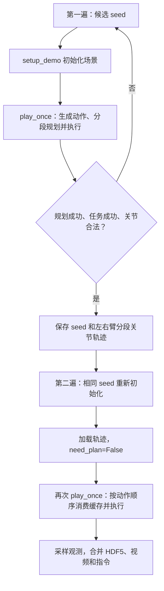

# RoboTwin 专家轨迹：读懂流程，再做可控修改

讨论稿 · 2026-10-13 · 示例任务：`stack_blocks_two`

本文以当前本地代码为准。目标是完成项目理解和完整调用链理解，并为独立修改一条轨迹准备一个可验证的小实验。本文中的实验、速度接口接入均是建议，尚未执行；本次没有修改采集或规划代码。

## 1. 先把两套“阶段”分开

学习层次和程序运行阶段是两回事。

| 学习层次 | 能够做到什么 | 当前建议 |
| --- | --- | --- |
| Level 1：项目理解 | 解释专家数据从哪里来、策略如何评测 | 用一段话讲清楚 |
| Level 2：调用链理解 | 从任务脚本追到位姿、规划、执行、保存 | 当前重点 |
| Level 3：小规模实验 | 改一个参数，预测影响，跑对照并解释结果 | 下一步，只选一个变量 |
| Level 4：新生成方法 | 多候选、多速度、评分和条件生成 | 留作后续研究 |

这里的专家数据由任务脚本读取仿真物体状态、构造末端目标，再经运动规划和物理仿真得到。学习策略的 policy rollout 是另一条执行链，不应与专家生成混在一起。

你提出的“初始化 → play_once → 回放保存”适合做阅读主线。但实际运行是两遍，而且两遍都会初始化场景、运行 `play_once()`：



第一遍是边规划边执行：后续目标可以依赖前面执行后的物体状态。它不是一次性把整个任务交给 cuRobo。第二遍复用机械臂轨迹，但夹爪动作仍由脚本生成；相同 seed 旨在重建同一场景，仍须检查回放是否成功。

## 2. 一条 trajectory 实际有四种表示

| 表示 | 示例 | 谁负责 |
| --- | --- | --- |
| 任务动作序列 | 抓红块、抬升、放下、抓绿块、堆叠 | `play_once()` |
| 末端关键位姿 | 预抓取、抓取、预放置、放置 | 动作原语和几何变换 |
| 稠密关节轨迹 | 每一步的 `position`、`velocity` | cuRobo 和执行器 |
| 训练样本序列 | 图像、state、下一采样帧的 action | 回放采样和 HDF5 转换 |

“修改轨迹”之前先说清楚：要改任务动作、空间路径、运动时间，还是保存的数据密度？它们不是同一个开关。

## 3. 用 stack_blocks_two 串起完整调用链

### 3.1 场景初始化：决定从哪里开始

`setup_demo()` → `Base_Task._init_task_env_()` → 场景、桌面、机器人、相机、`load_actors()`、稳定性检查。

`load_actors()` 随机采样两个方块的位置和绕竖直方向的朝向，并通过循环排除不符合距离要求的位置。`demo_clean` 关闭背景等随机化，不代表方块位置固定。

修改采样范围影响场景分布；固定某组物体位姿影响具体初始场景。只固定 seed 还依赖随机调用顺序不变：新增一次随机采样可能使后面的结果改变。严格对照最好同时记录实际物体位姿。

### 3.2 play_once：决定做什么

当前顺序：先处理红块，再处理绿块。`pick_and_place_block()` 的核心过程：

```text
按物体 x 坐标选择机械臂
→ grasp_actor：预抓取 → 接近 → 闭合
→ 向上移动 0.07 m
→ place_actor：预放置 → 放置 → 打开
→ 向上移动 0.07 m
```

第一个方块使用显式目标；第二个使用第一个方块的功能点作为目标。如果换手，抓下一块时可以让另一只手同步回原位。两个动作传给同一个 `move()` 时可能同步执行，不能简单按书写顺序理解成先完成一个再执行另一个。

任务成功条件检查绿块在红块上方的相对位置和夹爪打开状态。改变堆叠顺序或任务语义时，需要一起审视成功判据和语言描述。

### 3.3 动作原语：决定末端要到哪里

`grasp_actor()` 返回 `(arm_tag, [Action, ...])`，自己不执行运动。它经 `choose_grasp_pose()`、`get_grasp_pose()`，使用物体接触点生成预抓取和抓取目标。

- `contact_point_id`：限制考虑的抓取接触点。应先检查这个物体实际有哪些点。
- `pre_grasp_dis`：预抓取退让距离，示例为 0.09 m。
- `grasp_dis`：最终抓取位置的退让距离。
- `gripper_pos`：闭合后的目标开度。

当前候选选择主要依据方向偏好；内部虽定义 `check_pose()`，但该选择函数没有调用它。指定点并不等于证明可抓，仍需后续规划与物理执行验证。

两个同名放置函数的分工：

```text
transforms.get_place_pose()
    根据目标参考和放置规则，选物体/功能点的最终位姿
        ↓
Base_Task.get_place_pose()
    保持当前夹持关系，反推出夹爪目标，再加入退让距离
```

工具函数的位置采用 `target_pose`，朝向可能按规则重选。如果已经知道精确的参考点目标位姿，原则上可以直接结合当前夹持关系反推夹爪；重选朝向是任务设计选择，不是坐标变换的必需步骤。

这里的 `abs(dot(grasp_direct_vec, [0,0,1])) <= 0.1` 检查高度差不超过 10 cm。向量未归一化，它不是角度阈值。工具函数的 `free` 仍会做竖直方向对齐；`align` 额外调整平面方向。`z_transform=True` 实际对齐的是经过固定变换后的局部轴，不能一概认为是原始局部 +z。

### 3.4 规划与执行：决定中间怎么走

```text
move()
  → left/right_move_to_pose()
  → Robot.left/right_plan_path()
  → 夹爪坐标系目标转换为 end-link 目标
  → CuroboPlanner.plan_path()：世界目标转到机器人基座系
  → MotionGen.plan_single()
  → {status, position[N,J], velocity[N,J]}
  → take_dense_action() / together_move_to_pose()
  → 设置关节驱动目标 → scene.step()
```

`Robot.left_plan_path()` 是适配层。`communication_flag` 只决定直接调用规划器还是通过子进程调用。当前函数里的 `use_point_cloud`、`use_attach` 没有传入规划器，不能通过切换它们就认为开启了点云或附着物避障。

左右臂分别规划，再协调执行；这不是一次联合双臂规划。cuRobo 包装显式构建的世界障碍包含桌面，不能据此假设所有场景物体都已同步进规划器。

### 3.5 回放和保存：决定训练数据是什么

`need_plan=False` 时，机械臂动作按计数器读取 `left_joint_path/right_joint_path`。抓取函数中的七个零是未使用的占位目标，不会把机械臂规划到原点。

`_take_picture()` → `get_obs()` → 每帧 PKL → `create_xpolicylab_hdf5()`。

本地保存实现有两点必须记住：

- 关节字段来自 `get_drive_target()`，不是实际关节测量值。研究跟踪误差需另外记录实际 qpos。
- HDF5 将 `values[:-1]` 写为 state，`values[1:]` 写为 action，图像取前 N−1 帧。这里的 action 是下一采样帧绝对值，不是差分或原始 250 Hz 的全部控制命令。

## 4. 到底有哪些修改层次？

| 层次 | 想改变什么 | 入口 | 影响与注意点 |
| --- | --- | --- | --- |
| 场景 | 方块位置、朝向、间距 | `load_actors()`、随机配置 | 改变初始条件，可能同时改变选手和路径 |
| 任务顺序 | 先抓谁、哪只手、是否同步 | `play_once()`、`pick_and_place_block()` | 改变动作序列，检查成功条件和指令 |
| 抓取几何 | 从哪一侧抓、预抓取距离 | `contact_point_id`、`choose_grasp_pose()`、`grasp_actor()` | 改变目标位姿，不保证一定可抓 |
| 放置几何 | 放哪、朝向如何、用哪个功能点 | `place_actor()`、两个 `get_place_pose()` | 分清物体参考点目标与夹爪目标 |
| 空间路径 | 抬高绕行、增加经过点、保持朝向 | 任务中新增 `move()`、规划约束 | 增加经过点最直观；每段仍需规划验证 |
| 时间与速度 | 相同路径慢一点、接近段更慢 | 规划重定时、执行时序 | 必须一致处理位置采样、速度和时间 |
| 夹爪时序 | 开合快慢、等待、目标开度 | `plan_grippers()`、gripper action、`delay()` | 独立于机械臂速度，改变接触效果 |
| 数据采样 | 保存更密、改模态 | `save_freq`、`data_type`、保存函数 | 主要改变数据表达，不等于改变物理速度 |

前五层通常要重新规划并验证；速度重定时即使复用几何路径，也要重做物理成功检查。缓存里的手臂轨迹没有完整保存任务语义、夹爪事件与全局时间线，不能把它当作可任意剪接的完整 episode。

## 5. cuRobo 得到的轨迹是不是固定的？

它没有“抓方块固定模板”。它求解的是当前关节起点到给定末端目标之间的运动，结果受起点、目标、约束、碰撞模型、机器人限制和求解设置影响。

同一配置多次运行可能很接近，但这段包装没有承诺完全确定性，也不会自动产出丰富的轨迹变体。保存后第二遍读取的那份关节数组，才是明确固定的缓存。

想有意识改变路径，建议按下面顺序尝试：

1. 改一个明确的几何参数，例如抬升高度。
2. 指定不同抓取接触点或放置朝向。
3. 加一个中间末端位姿，分两段规划。
4. 熟悉前面几项之后，再研究多初值、多候选和规划代价。

`constraint_pose=[1,1,1,0,0,0]` 在本接口中表示对运动过程的朝向保持施加代价；不等于固定直线路径，也不是绝对无误差的硬锁定。

## 6. 速度能改，但先区分四种时间

| 项目 | 当前代码 | 含义 |
| --- | --- | --- |
| 物理步长 | 默认 `1/250` 秒 | 每次 `scene.step()` 推进的仿真时间 |
| 规划插值间隔 | `interpolation_dt=1/250` | 规划输出相邻样本的时间间隔 |
| 数据采样间隔 | `save_freq=15` | 通常每 15 个仿真步保存一次，段首尾还额外保存 |
| 视频播放帧率 | 视频工具默认 30 FPS | 影响播放观感，不改变仿真轨迹 |

常规段内采样约为 250/15≈16.7 Hz，不能直接把 `save_freq=15` 叫作 15 Hz。本地 HDF5 的 frequency 字段却直接写入这个值，后续做时间分析前需明确修正其语义；本文不修改该实现。

### 6.1 推荐先研究规划结果的重定时

已确认 robotwin 环境实际导入本地 `third_party/curobo_robotwin/src/curobo`。其中 `MotionGenPlanConfig` 支持 `time_dilation_factor`，`MotionGenResult.retime_trajectory()` 会调整时间、导数并重新插值。0.5 表示减速，理想时长约变为两倍。本地 RoboTwin 当前未暴露任务级速度参数。

待实现的最小全局验证可以在 `CuroboPlanner.plan_path()` 中尝试：

```python
# 建议实验，不是本次已应用的修改
plan_config = MotionGenPlanConfig(
    max_attempts=10,
    time_dilation_factor=0.5,
)
```

此思路也可对照 [cuRobo v0.7.6 官方源码](https://github.com/NVlabs/curobo/blob/v0.7.6/src/curobo/wrap/reacher/motion_gen.py)。当前仅核实接口和本地实现，未验证运行效果。

物理执行仍可能因接触、滑移而改变成功率。双臂同步函数还会协调两条轨迹的进度，因此先做单臂移动段验证，不能推断整个 episode 必定精确慢两倍。重定时后也应核对有效样本长度：库提供 `get_interpolated_plan()` 裁剪有效段，而当前包装直接读取 `interpolated_plan`。

如果只想让“接近物体”慢一点，需要把速度参数从指定 Action 沿 `move → left/right_move_to_pose → Robot → planner` 传下去，包含双臂分支与子进程消息。这是一次接口接入工作，当前只给 Action 增加自定义字段不会自动生效。

### 6.2 这些改法不能替代重定时

- 仅将 `velocity` 乘 0.5：位置目标仍按原速逐步推进，会造成位置和速度目标不一致。
- 仅增大 `save_freq`：只是少保存帧。
- 改视频 FPS 或插入墙钟 `sleep`：改变播放或现实等待时间，不改变每步的仿真时间。
- 单独改物理 timestep：会破坏与规划时间间隔的对应，还改变仿真数值行为。

若自己重采样，理想减速关系是 `q_new(t)=q_old(s*t)`、`v_new(t)=s*v_old(s*t)`，其中 0<s<1，并在固定物理步长下生成更长的位置与速度序列。还需一致安排夹爪事件和双臂时序。

夹爪有独立的 `plan_grippers()`，当前线性插值 200 步，按默认步长约 0.8 秒。改变它会改变开合过程；机械臂重定时不自动缩放夹爪时长。

## 7. 最容易导致“改了但没变化”的缓存问题

修改场景、抓取目标、动作顺序或规划设置后，不应继续拿旧缓存代表新方案。

两个容易忽略的恢复逻辑：

1. 即使 `use_seed=False`，存在的 `seed.txt` 仍会被加载并用于续跑；成功数已足够时可能不再规划。
2. 采集阶段会跳过已存在的连续 HDF5 episode。

建议每个实验变体使用独立输出目录，保留基线。数据放 `[data]/datasets/RoboTwin/experiments/...`，记录配置、代码版本及尚未提交的差异，不覆盖旧数据。

指定同一 seed 做对照需要一个可控的单 seed 入口：现有采集器主要做“不断尝试直到收集足够成功样本”，`episode_num=1` 不保证两个变体最后采用同一 seed；`use_seed=True` 又会连同旧轨迹一起复用。不要把它直接当成固定 seed 重新规划的开关。

修改动作数量尤其要重新生成缓存：左右臂计数器按调用顺序取段，旧缓存可能错配或越界。即使只改夹爪，也须重新验证整个任务，因为物理交互会变化。

## 8. 下一步只做一个小实验

建议第一个实验：**同一场景，把抓取后的抬升高度从 0.07 m 改为 0.12 m。** 注意当前函数里还有放置后的同名抬升，实验只修改抓取后的那一次。

理由：只涉及任务层的一个参数，容易预测效果、观察路径，也能练习完整规划与回放链。暂不同时修改布局、抓取点和速度。

| 项目 | 基线 | 变体 |
| --- | --- | --- |
| 初始场景 | 记录实际方块位姿和 seed | 保持一致 |
| 抓取点、预抓取距离 | 保持原设置 | 保持一致 |
| 抓取后抬升 | 0.07 m | 0.12 m |
| 放置后抬升 | 0.07 m | 不变 |
| 规划与回放缓存 | 独立目录 | 重新规划，独立目录 |

预期：抬升段目标更高，后续转移路径也可能改变，规划步数和时长可能增加；这不是速度控制实验。不保证一定成功，也不能假设其余路径完全相同。

需要保存的证据：

- 规划是否成功、关节是否合法、任务最终是否成功，以及失败发生在哪段。
- 初始物体位姿、每段末端目标、有效轨迹步数和仿真执行时长。
- 末端实际轨迹的俯视图/侧视图，以及同视角视频；图表和实际 qpos 记录需要补充，现有输出不全部提供。
- 规划执行与回放各自的结果。任务失败时也要保留诊断日志，而不只是统计筛选后的成功样本。

完成后再选第二个实验：改 `pre_grasp_dis`；第三个实验才是保持路径尽量一致、验证减速。先验证一对样本，再扩展到若干固定 seed，避免一开始全量采集。

验收标准是：能提前说明改动影响哪个层次，指出一条轨迹的完整来源，并用结果解释预期是否成立。无需此时就设计新的生成模型。

## 9. 阅读地图

链接指向源码文件，函数名是稳定定位入口；行号会随阅读注释变化。

| 顺序 | 文件 | 优先阅读 |
| --- | --- | --- |
| 1 | `collect_data.py`（源码路径；公开版见代码摘录页） | `run`：筛选、缓存、回放 |
| 2 | `stack_blocks_two.py`（源码路径；公开版见代码摘录页） | `load_actors`、`play_once`、`pick_and_place_block`、`check_success` |
| 3 | `_base_task.py`（源码路径；公开版见代码摘录页） | `grasp_actor`、`place_actor`、`move` |
| 4 | `transforms.py`（源码路径；公开版见代码摘录页） | `get_place_pose`，再回看外层同名函数 |
| 5 | `robot.py`（源码路径；公开版见代码摘录页） | `left_plan_path`、目标坐标变换、`set_arm_joints` |
| 6 | `planner.py`（源码路径；公开版见代码摘录页） | `CuroboPlanner.plan_path`、`plan_grippers` |
| 7 | `_base_task.py`（源码路径；公开版见代码摘录页） | `take_dense_action`、`together_move_to_pose`、`get_obs` |
| 8 | `pkl2hdf5.py`（源码路径；公开版见代码摘录页） | `create_xpolicylab_hdf5` |
| 9 | `本地 cuRobo`（源码路径；公开版见代码摘录页） | 做速度实验时再读 `retime_trajectory` |

## 10. 后续网页汇报结构

先讨论并确认本文，再制作网页。建议网页分为五部分：

1. 一张总流程图：两遍运行，初始化与执行的关系。
2. 一条可展开调用链：任务 → 位姿 → 规划 → 仿真 → 数据。
3. 修改层次表：每个修改项关联代码入口和预期影响。
4. 一个真实对照实验：参数、轨迹图、视频、成功/失败证据。
5. 后续研究：固定场景多抓取候选、路径多样性、速度控制。

网页中区分“已从源码确认”“建议实验”“已运行结果”，在实验执行前不填入成功率或效果结论。当前最适合先讨论的问题是：第一个对照实验选择抬升高度，还是预抓取距离？
