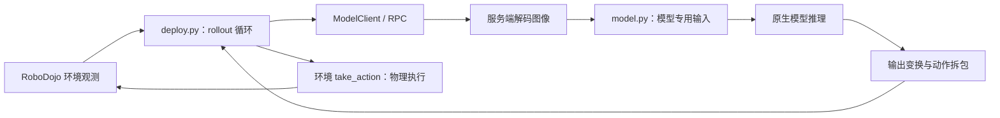

> 2026-10-14 实验更新：已新增 Pi_05 `set_policy_seed(seed)`，启用后 reset 重设原生 RNG。下文未改造时的行为保留为阅读基线；单环境串行实验入口见 `scripts/run_seeded_dojo_trial.py`，实测摘要见网页 randomness.html。该能力不是所有模型通用的 seed 接口，也不支持每环境独立 RNG。

# XPolicyLab wrapper：模型适配与同场景重复 rollout

讨论稿 · 2026-10-13 · 以本地 Pi_0 / Pi_05 适配器和 RoboDojo 客户端为主。配套：[RoboDojo 评测与评分](robodojo.md)。

这里的 wrapper 指模型适配层及其调用边界，不假设项目有一个单独命名为 wrapper 的统一文件。本文只读代码、设计实验，没有修改模型实现或启动评测。

## 1. wrapper 到底适配什么？

模型训练时使用的相机名字、图像排布、状态维度、归一化和动作格式各不相同。仿真环境则希望使用统一的观测和动作接口。



wrapper 不负责证明任务成功，不会因为包装了模型就自动使用 cuRobo 修正每个动作。RoboDojo 的评分由环境侧 RewardManager 处理；执行侧负责将动作转换为机器人控制。

## 2. 三层接口分工

| 层 | 文件 | 职责 |
| --- | --- | --- |
| 统一接口 | `model_template.py`（源码路径；公开版见代码摘录页） | 定义 update_obs、get_action、reset 和 batch 变体 |
| 模型适配 | `Pi_05/model.py`（源码路径；公开版见代码摘录页） | 加载模型、编码观测、调用 infer、拆包动作 |
| 闭环策略 | `Pi_05/deploy.py`（源码路径；公开版见代码摘录页） | 何时观察、何时推理、执行多少个动作、何时结束 |

服务入口 `setup_policy_server.py`（源码路径；公开版见代码摘录页） 动态导入 `XPolicyLab.policy.<policy_name>.model.Model`。默认协议是 WebSocket；代码虽导入 legacy TCP 类，但只有对应协议分支才使用它。

`WS model_server.py`（源码路径；公开版见代码摘录页） 将 RPC 方法名分派到模型对象。服务端先调用共享图像解码，再传给 adapter。RGB 在这条接口中已经统一，不应在模型里再次解码或随手加 BGR/RGB 交换。

## 3. 以 Pi_05 为例走一遍输入到输出

### 3.1 加载：模型权重之外还有配置和统计量

`Model.__init__()` 保存 action_type、机器人维度信息；`get_model()`：

```text
解析 checkpoint 路径
→ 选择 train_config_name
→ 按 repo_id 读取 assets 中的归一化统计量
→ create_trained_policy(config, checkpoint, norm_stats)
```

相同 checkpoint 如果搭配错误相机映射、机器人维度或归一化统计，行为也会不同。实验记录必须包含这些配置，不能只写“用了 Pi_05”。路径由公共 checkpoint resolver 和适配器的步骤选择逻辑处理。

### 3.2 输入：环境格式变成模型训练格式

`update_obs()` → `update_obs_batch()` → `encode_obs()`：

| 环境侧 | Pi_05 输入 |
| --- | --- |
| `vision` 中的头部图像 | `images.cam_high` |
| 左右腕部图像 | `images.cam_left_wrist`、`cam_right_wrist` |
| 机器人 `state` 字典 | pack 后的 float32 向量 |
| `instruction` | `prompt` |

图像由 `ensure_chw_uint8()` 调整为通道优先 uint8。随后原生 OpenPI policy 的输入 transforms 还会按训练配置处理数据、归一化和模型输入；不能把 adapter 的 encode_obs 当成全部预处理。

`process_data.py`（源码路径；公开版见代码摘录页） 的 pack 顺序：单臂 `[arm0, ee0]`；双臂 `[arm0, ee0, arm1, ee1]`。维度来自 `get_robot_action_dim_info(env_cfg_type)`，不是所有机器人都固定 14 维。

### 3.3 推理：一次返回 action chunk

`get_action()` 经 `get_action_batch()` 调用 `self.policy.infer(single_observation)["actions"]`。

当前 Pi_0/Pi_05 的 batch 实现会逐个环境调用 infer；有 batch API 不等于模型一次并行推理整个 batch。共享的模型随机数状态也随这些调用依次推进。

原生 policy 的输出 transforms 包括反归一化和配置相关变换，adapter 随后用 `unpack_robot_state()` 将每步动作拆回环境需要的各臂/夹爪字段。不要仅凭神经网络输出是一个向量，就假设它已是环境可直接使用的绝对关节角；需要追完整个输出变换链。

### 3.4 执行：模型预测长度与反馈频率是两回事

当前 Pi_05 `deploy.py` 的单环境逻辑：

```text
reset 模型
while episode 未结束:
    获取观测并 update_obs
    get_action → 得到一个 chunk
    for chunk 中每个 action:
        环境 take_action
        检查结束
        更新观测，但不在这里重新 get_action
```

也就是说：chunk 内虽然更新观测，但已经生成的剩余动作不会因此重算，通常要执行完 chunk 才再次推理。不能把“每步 update_obs”误认为“每步闭环重新规划”。

调整 chunk 执行前缀长度会改变反馈频率和行为，这是一个独立实验变量。比较不同模型时记录预测 horizon 和实际执行 horizon；不要默默改这个设置后将差异全部归因于模型能力。

环境侧 `take_action_batch()` 会识别 joint/末端类动作，将夹爪开度裁剪到 [0,1] 后映射到机器人控制范围，再由控制管理器执行。执行后的真实状态可能不同于发出的目标，轨迹分析要同时保存两者。

## 4. 适配器不都一样：不要泛化 Pi_05 的行为

| 项目 | Pi_0 / Pi_05 当前实现 | ACT 当前实现举例 |
| --- | --- | --- |
| 观测状态 | 保存最新编码观测 | 转交 ACT 自身的观测更新逻辑 |
| batch | adapter 内逐环境 infer | model.py 中 batch 方法仍是注释 TODO |
| reset | 清空 observation_window 和 env 索引 | 重置时间索引，启用 temporal aggregation 时清空聚合缓存 |
| 模型历史/随机性 | 需检查原生 policy 状态 | 需检查 ACT 内部状态与推理实现 |

入口：`Pi_0/model.py`（源码路径；公开版见代码摘录页）、`ACT/model.py`（源码路径；公开版见代码摘录页）。接口存在不代表每个 adapter 的 batch、reset 和历史行为相同。观察窗口名字也不说明一定保存了多帧历史。

## 5. 同一个场景为什么还能 rollout 出不同轨迹？

至少有四类来源，需要分开控制：

1. 场景不同：布局、资产、初始关节、相机、光照、指令或辅助机械臂状态没有完全固定。
2. 策略不同：采样噪声、随机种子、历史缓存或模型 checkpoint 不同。
3. 执行不同：chunk 长度、控制周期、裁剪、插值等适配/执行设置不同。
4. 仿真差异：接触求解和数值误差可能放大，微小初始差异导致后续动作分叉。

要分析“模型在同一 datagen 场景里的轨迹多样性”，首先应固定 1 和 3，再测 4 的基线，最后有意识改变 2。若模型是确定性推理且全部状态一致，重复运行可能几乎相同；不能保证每个模型天然有多样性。

## 6. 当前 reset 的关键缺口：不等于重置随机数

Pi_05 adapter 的 `reset()` 只有：

```python
self.observation_window = None
self._latest_env_idx_list = [0]
```

没有重置原生 policy 的 RNG。当前 OpenPI 的 JAX 分支初始默认 `jax.random.key(0)`，每次 infer 调用会 split 并更新 `_rng`；PyTorch 分支走对应采样实现，不能套用 JAX 的 reset 方法。

因此：

- 同一服务连续跑多次，即使每次调用 reset，后一次也可能用到不同采样随机状态。
- 如果每次重启服务且默认初始化相同，最初的噪声序列又可能相同。
- 多环境共享服务时，环境顺序和不同 episode 的 chunk 数会影响谁消耗哪段随机序列。
- 命令行配置里存在 `seed`，不代表 Pi_05 adapter 已把它传到原生 policy RNG；当前加载调用没有显式这样做。

源码：`OpenPI policy.py`（源码路径；公开版见代码摘录页）、`policy_config.py`（源码路径；公开版见代码摘录页）。Pi_0 有自己的同类源码副本，修改时需分别核实。

原生 infer 支持显式 `noise`，但当前通用 WS call 将 `obs` 作为位置参数分派，并不自动把任意 kwargs 转成 get_action 的参数。不能直接给 RPC 填一个 seed/noise 字段就宣称已生效。

建议后续增加一个公开方法，例如 `begin_trial(meta)`（尚未实现），通过现有携带字典的 RPC 调用：验证 trial 元信息、清空观测/历史/动作缓存、按后端设置 RNG，并回传实际应用的 policy_seed。对于多环境，使用每环境独立 RNG/状态；首轮实验先只用一个环境。

## 7. 现有字段与建议新增字段（2026-10-14 核实修订）

此前表格混合了实际字段和设计建议，且把现有 `trial_id` 错写成重复次数；此处纠正。核实范围是本地 RoboDojo 评测链路及 XPolicyLab Pi_05 适配器，不代表所有策略都相同。

| 字段 | 当前状态 | 实际语义或建议用途 |
| --- | --- | --- |
| `layout_id` | RoboDojo 已有 | 布局文件按数字后缀排序后的枚举索引；不是文件名后缀，也不是全局场景 ID |
| `scene_id` | 建议新增统一标识 | 跨项目实验使用；不要与现有 `layout_id` 当作同一字段 |
| `layout_hash` | 实验入口已记录 | 校验指定布局文件内容；不能证明物理状态、资产和首帧完全相同 |
| `eval_seed` | RoboDojo 已有 | 从 `eval_cfg.seed` 读取，参与选择 `Eval_Layout/<benchmark>/<config>/<seed>/` 目录；不是策略采样 seed |
| `policy_seed` | Pi_05 实验接口已接入 | set_policy_seed 设置后，reset 会重新应用；未设置时保留默认行为 |
| `trial_id` | 已有，但语义不同 | `task_name + ROBODOJO_RUN_ID`，传给 ModelClient 的通信/运行标识；不是同布局第几次 rollout |
| `repeat_id` | 实验入口已新增 | 单独表示同一场景的第几次 rollout，避免复用现有 trial_id |
| `policy_id` | 建议新增组合身份 | 现有 policy_name、checkpoint 配置及输入输出配置分散存在；建议记录可追溯组合身份 |

代码证据：`SeedManager.init_eval`（源码路径；公开版见代码摘录页）、`main 中 trial_id 的构造`（源码路径；公开版见代码摘录页）、`reset 与结果 layout_id`（源码路径；公开版见代码摘录页）、`Pi_05 reset`（源码路径；公开版见代码摘录页）。

同一个整数不要同时承担这几种含义。标准评测续跑按 layout 去重，重复实验需要独立 repeat 身份或隔离运行目录。

同一 datagen 场景首先是相同初始条件，不是回放同一条专家动作。后续每一步让模型基于自己的执行结果产生动作。

## 8. 通用方案草案（本次独立入口已实现部分能力）

先选一个普通刚体操作任务，固定一个 layout、一个模型，单环境串行运行：

```python
# 设计伪代码：begin_trial、record 等不是当前已存在接口
for repeat_id, policy_seed in enumerate(policy_seeds):
    env.reset_to_layout(saved_layout)
    verify_initial_state_and_instruction()
    policy.begin_trial({"repeat_id": repeat_id, "policy_seed": policy_seed})
    while not done:
        obs = env.get_obs()
        actions = policy.infer(obs)
        record_prediction(obs, actions, chunk_id)
        for action in chosen_execution_prefix(actions):
            env.take_action(action)
            record_actual_state_events_and_score()
            if done:
                break
    save_trial_result()
```

第一组固定同一个 policy_seed，检查重现误差；第二组换 policy_seed，观察采样多样性。保持执行前缀与基线 deploy 一致，除非实验明确研究反馈频率。

每次 reset 都验证对象位姿、机器人关节、实际指令和首帧观测；动态/液体/布料场景还要明确额外状态恢复方式。不要把布局 JSON 自动等同于完整可重复的物理快照。

建议结果组织：

```text
[data]/outputs/rollout_variation/<experiment>/
  scene_<id>/<policy_id>/trial_<id>/
    meta.json       # 配置、种子、版本、layout_hash、指令
    trajectory.hdf5 # 时间戳、动作、实际状态、物体位姿、评分事件
    result.json     # success、score、结束原因、有效性
    videos/         # 固定视角
```

这些是建议产物，不是目前评测器已自动生成的文件。

## 9. 记录位置：定位差异到底从哪一层产生

| 插入位置 | 应记录什么 | 排查问题 |
| --- | --- | --- |
| 环境 reset 后 | 初始实际状态、布局哈希、指令 | 场景是否真的相同 |
| adapter encode_obs 后 | 模型输入形状、映射、状态向量 | 模型看到的是否相同 |
| 原生 infer 输出后 | 经过输出 transforms 的完整 chunk | 模型预测如何分叉 |
| unpack 后 / take_action 前 | 结构化目标动作、chunk 索引 | 是否被适配或裁剪改变 |
| 控制执行后 | 实际 qpos、末端、物体位姿、仿真时间 | 跟踪和物理交互差异 |
| RewardManager 更新后 | 阶段、谓词、score 和 success | 差异是否影响任务结果 |

若需要模型归一化空间中的原始输出，应在原生输出 transforms 前单独加记录，不能把 infer 返回值误称为未处理的网络输出。图像不必每个物理步重复写入，可以采用统一采样频率并记录时间戳。

差异比较可分两级：先固定同一观测离线重复 infer，分析动作采样；再从同一场景闭环 rollout，分析状态反馈放大的轨迹差异。前者便宜但不能替代后者。

## 10. 下一步的实现范围与汇报结构

需要补充的最小能力：

1. 指定 layout + K 次 trial 的实验入口，与标准评测恢复逻辑隔离。
2. 可验证的 per-trial policy RNG reset，保留模型原有历史重置语义。
3. 动作与实际状态 recorder，以及独立异常/无效 trial 标记。
4. 固定场景的轨迹叠图、阶段对齐、成功率与部分分数分布。

网页汇报可以按“同一场景 → 多条 rollout → 输入/动作/物理三层差异 → 任务评分与轨迹指标”展开。现阶段先确认研究问题是“同模型采样多样性”还是“不同模型行为差异”；两者可共用记录格式，但需要不同对照。

初稿核实了调用链、chunk 行为、评分边界和 reset/RNG 缺口。本次已新增 Pi_05 串行 seed 接口、固定布局重复评测与记录入口；实际完成状态、结果和初始观测差异见网页实测区。通用多模型、多环境独立 RNG 和统一实验管理仍未实现。


## 本次实测补充

Pi_05 / RoboDojo stack_blocks 布局 0 的 `[0,0,1,2]` 四轮均已完成，最终分为 `[0,15,0,0]`，均未完整成功。固定同一份观测的离线对照中，相同 seed 输出完全一致，不同 seed 输出不同；闭环重复中虽然记录的初始位姿一致，但三路图像略有差异。因此 `policy_seed` 生效不等于整条闭环轨迹严格复现。详细结果与归因边界见 RoboDojo 文档末尾及 randomness.html 实测区。
